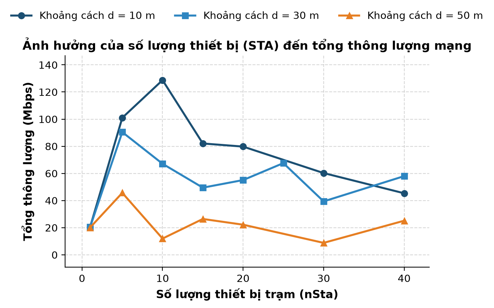
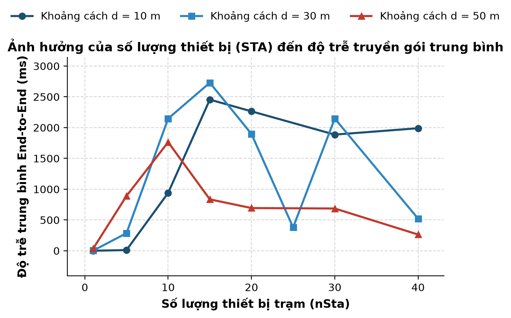
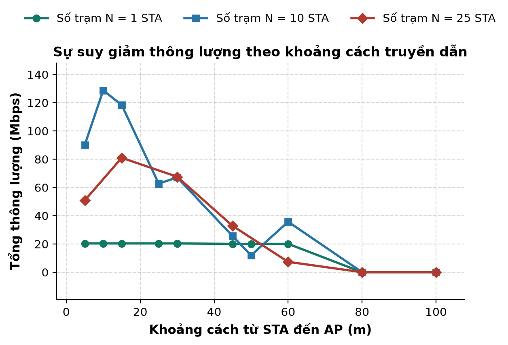
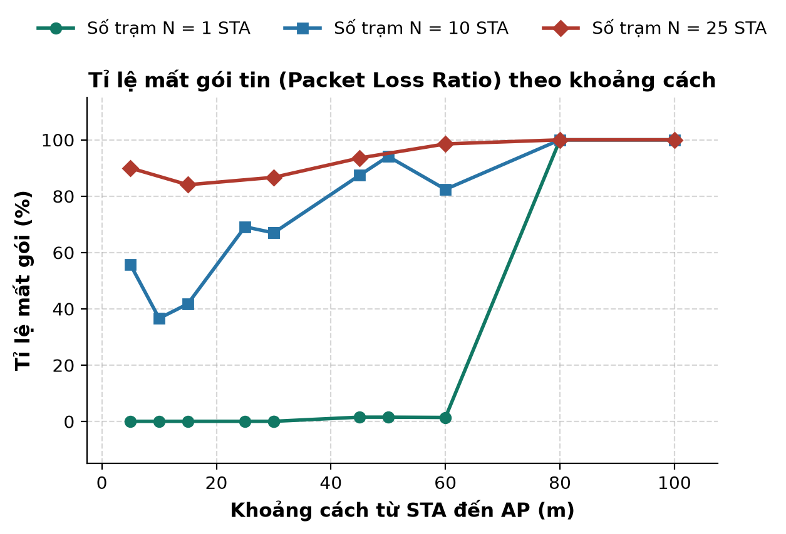

# Khảo sát ảnh hưởng của số lượng thiết bị và khoảng cách đến hiệu năng mạng Wi-Fi bằng ns-3

Dự án mô phỏng một mạng Wi-Fi (1 Access Point + N thiết bị) trên bộ mô phỏng **ns-3**, đo các chỉ số
hiệu năng (thông lượng, độ trễ, tỉ lệ mất gói, jitter, độ công bằng) khi thay đổi:

- **số lượng thiết bị** (1 – 40 trạm),
- **khoảng cách** từ thiết bị tới AP (5 – 100 m),
- **cơ chế RTS/CTS** (bật / tắt).

Sau đó tự động tổng hợp kết quả thành bảng số liệu và đồ thị để đưa vào báo cáo.

> README này viết cho người **chưa từng cài WSL hay ns-3**. Cứ làm lần lượt từ Phần 3.
> Người dùng Linux có thể bỏ qua bước 3.1 – 3.2 (cài WSL).

---

## 1. Cấu trúc thư mục

```
ns3-wifi-survey/
├── README.md               # Tài liệu này
├── wifi-survey.cc          # Chương trình mô phỏng ns-3 (C++), file chính
├── run_experiments.sh      # Chạy tự động 56 lượt mô phỏng, ghi results.csv
├── plot_results.py         # Vẽ 4 đồ thị từ results.csv  -> figures/
├── make_tables.py          # In/lưu các bảng số liệu từ results.csv -> tables/
├── measure_resources.sh    # Đo thời gian chạy và RAM (cho phần đánh giá tài nguyên)
├── install_to_ns3.sh       # Chép các file trên vào đúng chỗ trong thư mục ns-3
├── figures/                # Đồ thị mẫu đã vẽ sẵn (4 ảnh PNG)
├── .gitignore
└── .gitattributes
```

Sau khi chạy, sẽ xuất hiện thêm (trong thư mục ns-3): `results.csv`, `figures/`, `tables/`, `run.log`.

---

## 2. Kiến trúc code

### 2.1. Luồng xử lý tổng thể

```
 run_experiments.sh
   │  gọi 56 lần:  ./ns3 run "scratch/wifi-survey --nSta=.. --distance=.. ..."
   ▼
 wifi-survey.cc  (mỗi lần chạy = 1 phiên mô phỏng độc lập)
   │  ghi nối tiếp 1 dòng vào
   ▼
 results.csv
   ├──► plot_results.py  ──► figures/fig1..fig4_*.png   (4 đồ thị)
   └──► make_tables.py   ──► tables/bang_6_1..6_3.csv   (3 bảng) + in gợi ý số liệu

 measure_resources.sh ──► resources.txt   (thời gian chạy + RAM đỉnh, tách riêng)
```

### 2.2. Mô hình mạng trong `wifi-survey.cc`

- **1 AP** đặt tại gốc tọa độ (0, 0, 0).
- **N trạm (STA)** đứng yên, xếp **đều trên đường tròn bán kính d** quanh AP, nên mọi trạm cùng cách AP đúng d mét.
- Mỗi trạm gửi **UDP liên tục (CBR) về AP** (chiều lên – uplink), mặc định 20 Mbps/trạm, gói 1472 byte.
  Các trạm khởi động lệch pha nhẹ (1.0 – 1.1 s) để tránh va chạm giả lúc đầu.
- Kênh truyền: suy hao Log-Distance (hệ số n = 3.0, suy hao tham chiếu 46.6777 dB tại 1 m), công suất phát 20 dBm.
- Chuẩn Wi-Fi: **IEEE 802.11ax**; điều khiển tốc độ: **MinstrelHt**.
- RTS/CTS: tắt bằng cách đặt ngưỡng 65535 byte, bật bằng ngưỡng 100 byte.

### 2.3. Các bước trong `main()` của `wifi-survey.cc`

| Bước | Nội dung |
|---|---|
| 1 | Đọc tham số dòng lệnh (`CommandLine`), đặt hạt giống ngẫu nhiên |
| 2 | Tạo node: 1 AP + `nSta` STA |
| 3 | Tạo kênh vô tuyến (`YansWifiChannel` + `LogDistancePropagationLossModel`) và PHY |
| 4 | Cấu hình 802.11ax, MinstrelHt, MAC của STA (`StaWifiMac`) và AP (`ApWifiMac`) |
| 5 | Đặt vị trí: AP ở tâm, các STA trên đường tròn bán kính `distance` |
| 6 | Cài ngăn xếp Internet, cấp IP dải `192.168.1.0/24` |
| 7 | Tạo ứng dụng: `OnOffApplication` trên mỗi STA, `PacketSink` trên AP (cổng 5000 + i) |
| 8 | Bật `FlowMonitor` |
| 9 | Chạy mô phỏng, rồi chỉ lấy các luồng chiều lên (đích là IP của AP, cổng ≥ 5000) để tính chỉ số |
| 10 | In tóm tắt ra màn hình và **ghi nối tiếp 1 dòng vào `results.csv`** |

### 2.4. Tham số dòng lệnh của chương trình

| Tham số | Mặc định | Ý nghĩa |
|---|---|---|
| `--nSta` | 10 | Số trạm |
| `--distance` | 20 | Khoảng cách STA – AP (mét) |
| `--simTime` | 15 | Thời gian mô phỏng (giây) |
| `--payloadSize` | 1472 | Kích thước gói (byte) |
| `--dataRate` | 20Mbps | Tốc độ gửi của **mỗi** trạm |
| `--protocol` | UDP | `UDP` hoặc `TCP` |
| `--enableRtsCts` | false | Bật RTS/CTS (`true`/`false`) |
| `--seed` | 1 | Chỉ số lần chạy (`RngRun`), đổi để chạy lặp lấy trung bình |
| `--csvFile` | results.csv | File CSV nhận kết quả |

Ví dụ chạy tay một cấu hình: `./ns3 run "scratch/wifi-survey --nSta=10 --distance=30 --enableRtsCts=true"`

### 2.5. Các cột trong `results.csv`

`nSta, distance, protocol, rtsCts, seed, totalThroughputMbps, perStaThroughputMbps, avgDelayMs, avgJitterMs, packetLossPct, jainsFairness, txPackets, rxPackets`

### 2.6. Ba kịch bản trong `run_experiments.sh`

| Kịch bản | Biến thay đổi | Cố định | Số lượt |
|---|---|---|---|
| 1 | `nSta` ∈ {1, 5, 10, 15, 20, 30, 40} | d = 10, 30, 50 m; RTS/CTS tắt | 21 |
| 2 | `distance` ∈ {5, 15, 30, 45, 60, 80, 100} m | nSta = 1, 10, 25; RTS/CTS tắt | 21 |
| 3 | `nSta` như kịch bản 1 | d = 25 m; so sánh RTS/CTS **bật** (7 lượt) với **tắt** (7 lượt, Bước 5 trong script) | 14 |

Tổng cộng **56 lượt** (`results.csv` có 57 dòng gồm cả dòng tiêu đề). Một số cấu hình trùng nhau giữa
kịch bản 1 và 2 (ví dụ nSta = 10, d = 30); `make_tables.py` tự loại các dòng trùng.

---

## 3. Hướng dẫn cài đặt và chạy (từ con số 0, trên Windows)

### Yêu cầu máy

- Windows 10 (bản 2004 trở lên) hoặc Windows 11.
- RAM **8 GB trở lên** (khuyến nghị 16 GB), ổ cứng trống khoảng **15 GB**.
- Nếu `wsl --install` báo lỗi ảo hóa: vào BIOS bật **Virtualization (VT-x / SVM)**.

### 3.1. Cài WSL (Ubuntu trên Windows)

1. Bấm chuột phải vào nút Start, chọn **Terminal (Admin)** hoặc **Windows PowerShell (Admin)**.
2. Gõ lệnh sau rồi Enter:
   ```powershell
   wsl --install -d Ubuntu
   ```
3. **Khởi động lại máy** khi được yêu cầu.
4. Mở **Ubuntu** từ menu Start. Lần đầu sẽ chờ vài phút, sau đó nhập **tên người dùng** và **mật khẩu**
   (khi gõ mật khẩu sẽ không thấy ký tự hiện ra, đó là bình thường).

Từ giờ, **mọi lệnh ở các phần sau đều gõ trong cửa sổ Ubuntu** (gọi là "terminal WSL"), trừ khi có ghi rõ khác.

### 3.2. (Khuyến nghị) Cấp thêm bộ nhớ ảo cho WSL

Việc biên dịch ns-3 ngốn nhiều RAM; nếu thiếu, trình biên dịch sẽ bị hệ điều hành kill (lỗi
`Killed signal terminated program cc1plus`).

1. Mở Notepad, nhập nội dung:
   ```ini
   [wsl2]
   swap=8GB
   ```
2. Lưu thành file `C:\Users\<tên-Windows-của-bạn>\.wslconfig` (chọn *Save as type: All files* để không bị thêm đuôi `.txt`).
3. Mở PowerShell, gõ `wsl --shutdown`, rồi mở lại Ubuntu.

### 3.3. Cài các gói cần thiết

```bash
sudo apt update
sudo apt install -y g++ cmake ninja-build git python3 python3-pip ccache \
                    python3-pandas python3-matplotlib time
```

### 3.4. Tải ns-3 và tải dự án này

Luôn làm việc trong thư mục home của Ubuntu (`~`), **đừng** để trong `/mnt/c/...` vì rất chậm.

```bash
mkdir -p ~/ns3-project && cd ~/ns3-project
git clone https://gitlab.com/nsnam/ns-3-dev.git
git clone https://github.com/<tên-tài-khoản>/<tên-repo>.git ns3-wifi-survey
```

(Thay `<tên-tài-khoản>/<tên-repo>` bằng địa chỉ repo GitHub của dự án này.)

> Dự án được chạy thử trên nhánh phát triển `ns-3-dev`. Mã nguồn ghi tương thích ns-3.36 trở lên,
> nhưng các bản phát hành chính thức (ví dụ ns-3.42) chưa được kiểm thử trong dự án này.

### 3.5. Cấu hình và biên dịch ns-3 (mất khoảng 10 – 40 phút)

```bash
cd ~/ns3-project/ns-3-dev
./ns3 configure -d optimized --disable-tests --disable-examples \
    --enable-modules="wifi;applications;flow-monitor;mobility;internet;network;core"
./ns3 build -j 3
```

Giải thích: `-d optimized` giúp mô phỏng chạy nhanh; `--disable-tests/examples` và danh sách module bỏ
bớt phần không cần để build nhẹ; `-j 3` giới hạn 3 tiến trình biên dịch song song để không hết RAM
(máy 16 GB trở lên có thể tăng lên `-j 6`). Nếu vẫn thấy `Killed`, hạ xuống `-j 2` hoặc `-j 1`.
Nếu lỡ đóng terminal giữa chừng, chỉ cần chạy lại `./ns3 build -j 3`, nó sẽ làm tiếp từ chỗ dở.

### 3.6. Chép code của dự án vào ns-3

```bash
cd ~/ns3-project/ns3-wifi-survey
bash install_to_ns3.sh ~/ns3-project/ns-3-dev
```

Script này chép `wifi-survey.cc` vào `ns-3-dev/scratch/`, và 4 file còn lại
(`run_experiments.sh`, `measure_resources.sh`, `plot_results.py`, `make_tables.py`) vào thư mục gốc `ns-3-dev/`.

Sau đó build lại để ns-3 nhận file mới:

```bash
cd ~/ns3-project/ns-3-dev
./ns3 build -j 3
```

### 3.7. Chạy thử một lần

```bash
./ns3 run "scratch/wifi-survey --nSta=5 --distance=10"
cat results.csv
```

Thành công khi thấy dòng dạng `[DONE] nSta=5 | dist=10m | proto=UDP | RTS/CTS=OFF --> TotalThr=... Mbps ...`
và file `results.csv` có 1 dòng tiêu đề + 1 dòng dữ liệu. Xóa file này trước khi chạy thật: `rm results.csv`.

### 3.8. Chạy toàn bộ thí nghiệm (56 lượt)

Chạy nền để đóng cửa sổ terminal cũng không bị dừng:

```bash
nohup ./run_experiments.sh > run.log 2>&1 &
tail -f run.log        # xem tiến độ; thoát xem bằng Ctrl+C (script vẫn chạy)
```

Khi thấy dòng `HOÀN TẤT!` trong `run.log`, kiểm tra đủ dữ liệu:

```bash
wc -l results.csv      # phải ra 57
```

Lưu ý: đừng tắt hẳn WSL hoặc để máy sleep trong lúc chạy. Script tự xóa `results.csv` cũ khi bắt đầu.

### 3.9. Tạo bảng số liệu và đồ thị

```bash
python3 make_tables.py     # in 3 bảng + gợi ý số liệu; lưu vào thư mục tables/
python3 plot_results.py    # vẽ 4 đồ thị vào thư mục figures/
```

### 3.10. (Tùy chọn) Đo thời gian chạy và RAM

```bash
./measure_resources.sh
```

In ra thời gian chạy và RAM đỉnh cho 1, 20 và 40 trạm (lưu trong `resources.txt`).
RAM tính bằng KB, chia 1024 để ra MB.

### 3.11. Lấy kết quả ra Windows

Cách 1: mở thư mục WSL bằng Windows Explorer ngay từ terminal:

```bash
cd ~/ns3-project/ns-3-dev
explorer.exe .
```

Cách 2: trong Windows Explorer, gõ vào thanh địa chỉ
`\\wsl.localhost\Ubuntu\home\<tên-người-dùng-Ubuntu>\ns3-project\ns-3-dev`
(Windows 10 dùng `\\wsl$\Ubuntu\...`).

Cách 3: chép bằng lệnh (thay `TenBan` bằng tên user Windows):

```bash
cp -r figures tables results.csv /mnt/c/Users/TenBan/Desktop/
```

---

## 4. Kết quả mẫu (hạt giống = 1, ns-3-dev, WSL2)

Đồ thị vẽ sẵn nằm trong `figures/`:






Nhận xét tóm tắt từ số liệu đo được:

- **Số lượng thiết bị:** thông lượng tăng gần tuyến tính đến 5 trạm (20.37 → 101.00 Mbps tại d = 10 m),
  đạt đỉnh **128.75 Mbps tại 10 trạm** rồi giảm còn 45.35 Mbps tại 40 trạm. Độ trễ nhảy từ 11.13 ms (5 trạm)
  lên khoảng 940 ms (10 trạm) rồi chững quanh 2 giây; tỉ lệ mất gói lên tới 94 %, độ công bằng Jain giảm còn 0.466.
- **Khoảng cách:** với 1 trạm, thông lượng ổn định (~20 Mbps) đến 60 m rồi mất kết nối hoàn toàn ở 80 m.
  Với nhiều trạm, thông lượng giảm dần từ khoảng 15 m trở đi.
- **RTS/CTS (d = 25 m):** khi mạng thưa (1 – 5 trạm) hai cơ chế gần như bằng nhau; từ 10 trạm trở lên bật RTS/CTS
  tăng thông lượng khoảng 70 – 140 % so với Baseline (ví dụ 10 trạm: 62.71 → 135.82 Mbps).

<details>
<summary>Bảng số liệu chi tiết</summary>

**Bảng 1 – Theo số trạm** (định dạng `d=10 m / d=30 m`)

| nSta | Thông lượng (Mbps) | Độ trễ (ms) | Mất gói (%) | Jain |
|---|---|---|---|---|
| 1 | 20.37 / 20.37 | 0.11 / 2.38 | 0.06 / 0.07 | 1.000 / 1.000 |
| 5 | 101.00 / 90.44 | 11.13 / 285.12 | 0.60 / 10.99 | 1.000 / 0.999 |
| 10 | 128.75 / 67.10 | 940.13 / 2146.24 | 36.62 / 66.97 | 0.984 / 0.829 |
| 15 | 82.06 / 49.49 | 2454.19 / 2728.57 | 73.07 / 83.76 | 0.777 / 0.698 |
| 20 | 79.77 / 55.08 | 2264.17 / 1897.31 | 80.36 / 86.44 | 0.809 / 0.540 |
| 30 | 60.25 / 39.36 | 1886.10 / 2147.04 | 90.11 / 93.54 | 0.456 / 0.466 |
| 40 | 45.35 / 58.00 | 1989.71 / 521.36 | 94.42 / 92.86 | 0.466 / 0.162 |

**Bảng 2 – Theo khoảng cách** (định dạng `N=1 / N=10`)

| d (m) | Thông lượng (Mbps) | Thông lượng/trạm, N=10 (Mbps) | Độ trễ (ms) | Mất gói (%) |
|---|---|---|---|---|
| 5 | 20.37 / 90.11 | 9.01 | 0.08 / 1410.32 | 0.06 / 55.64 |
| 15 | 20.37 / 118.35 | 11.83 | 0.10 / 930.40 | 0.07 / 41.74 |
| 30 | 20.37 / 67.10 | 6.71 | 2.38 / 2146.24 | 0.07 / 66.97 |
| 45 | 20.07 / 25.54 | 2.55 | 34.87 / 1062.78 | 1.54 / 87.43 |
| 60 | 20.09 / 35.71 | 3.57 | 27.67 / 457.27 | 1.44 / 82.42 |
| 80 | 0.00 / 0.00 | 0.00 | 0.00 / 0.00 | 100.00 / 100.00 |
| 100 | 0.00 / 0.00 | 0.00 | 0.00 / 0.00 | 100.00 / 100.00 |

**Bảng 3 – Baseline DCF so với RTS/CTS, d = 25 m**

| nSta | Thông lượng Baseline | Thông lượng RTS/CTS | Mất gói Baseline (%) | Mất gói RTS/CTS (%) |
|---|---|---|---|---|
| 1 | 20.37 | 20.37 | 0.07 | 0.07 |
| 5 | 100.57 | 101.40 | 1.02 | 0.21 |
| 10 | 62.71 | 135.82 | 69.13 | 33.14 |
| 15 | 58.58 | 100.52 | 80.77 | 67.01 |
| 20 | 48.02 | 115.51 | 88.18 | 71.56 |
| 30 | 46.43 | 93.76 | 92.38 | 84.61 |
| 40 | 45.92 | 92.50 | 94.35 | 88.61 |

</details>

File `results.csv` gốc của lần chạy này nên được thêm vào repo (thư mục `results/`) để người khác đối chiếu.

---

## 5. Lưu ý khi diễn giải kết quả

- **Mỗi cấu hình chỉ chạy 1 hạt giống** (`--seed=1`), nên đồ thị có điểm không đơn điệu (ví dụ d = 30 m,
  40 trạm cao hơn 30 trạm). Muốn số liệu chắc hơn, chạy mỗi cấu hình nhiều seed (`--seed=1..5`) rồi lấy trung bình.
- **Tải đưa vào rất lớn:** mỗi trạm gửi 20 Mbps, nên từ khoảng 10 trạm trở lên tổng tải vượt dung lượng kênh.
  Đây là bài kiểm tra bão hòa (stress test); tỉ lệ mất gói cao và độ trễ lớn ở mật độ cao là hệ quả của cấu hình này.
- **Độ trễ trung bình có thể bị thấp hơn thực tế** khi một số trạm bị "bỏ đói": trong code, tổng độ trễ chỉ cộng các
  luồng có nhận được gói nhưng lại chia cho tổng số luồng (kể cả luồng không nhận được gói nào).
- Mô hình suy hao Log-Distance là mô hình thống kê trung bình, chưa tính vật cản và pha-đinh đa đường,
  nên bán kính phủ sóng thực tế thường ngắn hơn kết quả mô phỏng.

---

## 6. Xử lý sự cố thường gặp

| Hiện tượng | Nguyên nhân và cách xử lý |
|---|---|
| `Killed signal terminated program cc1plus` khi build | Hết RAM. Hạ `-j` xuống 2 hoặc 1, và làm bước 3.2 (tăng swap) |
| `./ns3: command not found` | Đang đứng sai thư mục. Phải `cd` vào thư mục `ns-3-dev` (nơi có file `ns3`) |
| `No such file or directory: scratch/wifi-survey` | Chưa chép file, hoặc chưa build lại. Chạy lại bước 3.6 |
| `\r: command not found` khi chạy `.sh` | File bị xuống dòng kiểu Windows. Chạy `sed -i 's/\r$//' *.sh` |
| `Permission denied` khi chạy `.sh` | Chạy `chmod +x run_experiments.sh measure_resources.sh` |
| `No module named pandas` | `sudo apt install -y python3-pandas python3-matplotlib` |
| Có file `...:Zone.Identifier` lạ | Metadata Windows sinh ra khi kéo file vào WSL, xóa bằng `rm -f *:Zone.Identifier` |
| `results.csv` không đủ 57 dòng | Có lượt chạy bị lỗi. Xem `run.log` để tìm lượt hỏng, rồi chạy lại script |

---

## 7. Giấy phép và tác giả

Thêm thông tin tác giả và giấy phép (ví dụ MIT) vào phần này trước khi công khai repo.
